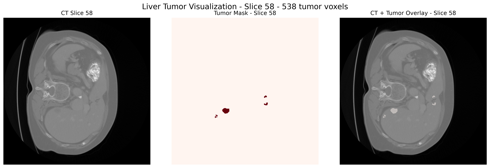

# CT Tumor Segmentation

End-to-end 3D CT tumor segmentation project using Python, PyTorch, MONAI and medical imaging data.

## Overview

This project focuses on 3D medical image analysis and tumor segmentation from CT volumes.

The initial development phase uses the Medical Segmentation Decathlon `Task03_Liver` dataset and currently includes:

- loading NIfTI medical images
- loading segmentation masks
- inspecting CT volume shape and intensity range
- extracting voxel spacing from the NIfTI affine matrix
- identifying tumor voxels from ground-truth labels
- automatically selecting the slice with the largest tumor area
- visualizing CT, tumor mask and tumor overlay
- estimating tumor volume from voxel spacing and segmentation labels

The final goal is to develop a reproducible 3D tumor segmentation pipeline using deep learning.

---

## Project Structure

```text
ct-tumor-segmentation/
├── configs/
├── data/
│   └── sample/
│       ├── image/
│       │   └── liver_0.nii.gz
│       └── label/
│           └── liver_0.nii.gz
├── docs/
│   └── images/
│       └── liver_0_tumor_overlay.png
├── notebooks/
├── outputs/
├── src/
│   ├── __init__.py
│   ├── analysis/
│   │   ├── __init__.py
│   │   └── tumor_metrics.py
│   ├── data/
│   │   ├── __init__.py
│   │   └── io.py
│   └── visualization/
│       ├── __init__.py
│       └── plot_slice.py
├── tests/
│   ├── __init__.py
│   ├── test_io.py
│   ├── test_tumor_metrics.py
│   └── test_visualization.py
├── .gitignore
├── README.md
└── requirements.txt
```

---

## Tumor Visualization

The visualization pipeline generates a three-panel figure:

1. Original CT slice
2. Tumor segmentation mask
3. CT with tumor-mask overlay


