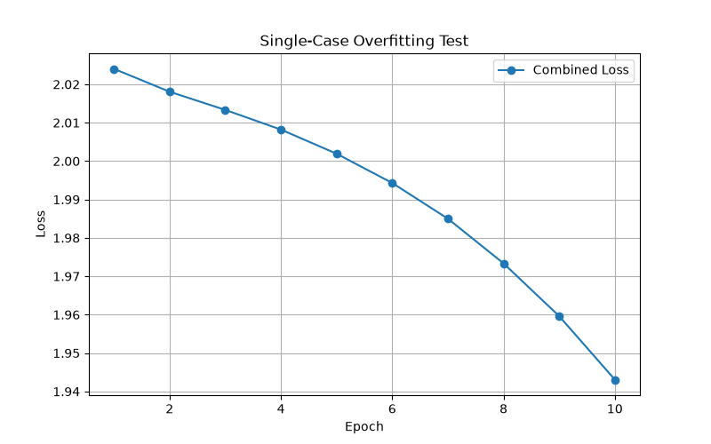
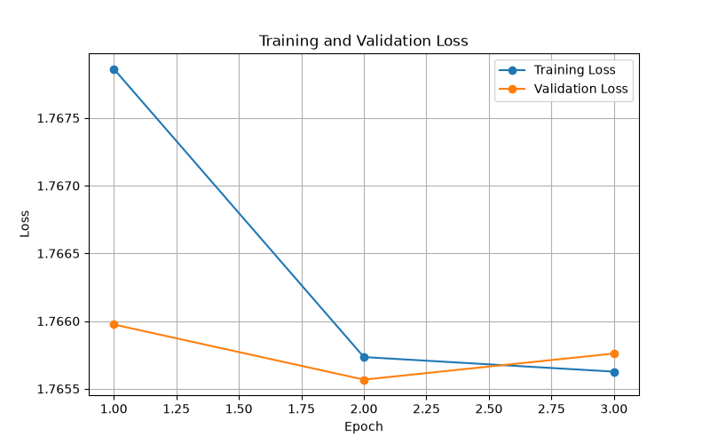
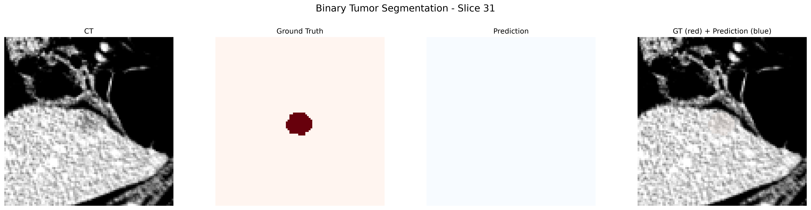
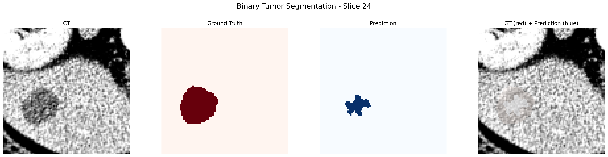
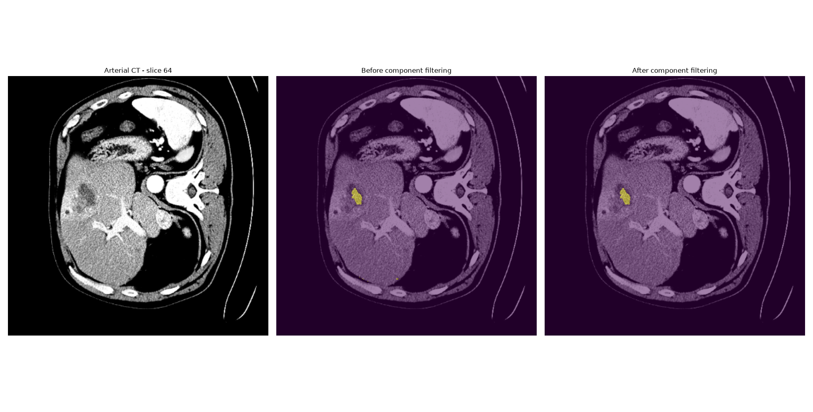

# 3D CT Tumor Segmentation

End-to-end medical imaging project for 3D CT tumor segmentation using Python, PyTorch, SciPy, pydicom, and NIfTI/DICOM imaging data.

The project progressively explores the complete workflow from medical image loading and preprocessing to deep learning segmentation, quantitative evaluation, DICOM reconstruction, full-volume inference, and anatomically constrained post-processing.

> **Disclaimer**
>
> This project is developed for educational and research purposes only.
> It is not a medical device and must not be used for diagnosis, treatment planning, or clinical decision-making.

---

## Overview

The project was designed to study the complete lifecycle of a medical imaging AI pipeline rather than focusing only on neural network training.

The workflow currently includes:

```text
Medical imaging data
        ↓
Image loading
        ↓
Geometry and voxel spacing
        ↓
CT intensity interpretation
        ↓
Windowing
        ↓
Normalization
        ↓
Resampling
        ↓
3D patch extraction
        ↓
PyTorch Dataset / DataLoader
        ↓
3D U-Net
        ↓
Training and validation
        ↓
Voxel-wise evaluation
        ↓
Lesion-wise evaluation
        ↓
Post-processing
        ↓
DICOM series reconstruction
        ↓
DICOM SEG integration
        ↓
Sliding-window full-volume inference
        ↓
Anatomically constrained prediction
```

The first phases use a liver CT segmentation dataset distributed in NIfTI format.

The later phases introduce real DICOM CT studies in order to bridge the gap between a research-oriented workflow and a clinical imaging workflow.

---

# Project Structure

```text
ct-tumor-segmentation/
│
├── configs/
│
├── data/
│   ├── multicase/
│   ├── sample/
│   └── dicom/
│       ├── lidc_idri/
│       ├── liver_portal_venous/
│       ├── liver_arterial/
│       └── liver_seg/
│
├── docs/
│   └── images/
│
├── notebooks/
│
├── outputs/
│   ├── checkpoints/
│   └── evaluation/
│
├── src/
│   ├── data/
│   ├── dicom/
│   ├── evaluation/
│   ├── inference/
│   ├── models/
│   ├── preprocessing/
│   ├── training/
│   └── visualization/
│
├── tests/
│
├── .gitignore
├── README.md
└── requirements.txt
```

Medical imaging datasets, model checkpoints, and generated outputs are intentionally excluded from version control when appropriate.

---

# Dataset

## NIfTI Liver CT Dataset

The initial segmentation experiments use the liver task from the Medical Segmentation Decathlon.

The label convention is:

```text
0 = background
1 = liver
2 = tumor
```

A typical CT volume contains:

```text
Shape:
512 × 512 × N slices

Voxel spacing:
approximately sub-millimeter in-plane
with larger spacing along the slice axis
```

The project initially uses a small subset of cases to keep experimentation computationally manageable.

The current exploratory patient-level split contains:

```text
8 training patients
2 validation patients
```

This is intentionally small and must not be interpreted as sufficient for estimating clinical performance.

---

# Phase 1 — Medical Image Exploration

The first phase focuses on understanding medical images before introducing deep learning.

Implemented steps include:

- loading NIfTI CT volumes;
- loading segmentation masks;
- inspecting image shapes;
- inspecting voxel spacing;
- identifying label values;
- visualizing axial CT slices;
- overlaying tumor masks;
- automatically identifying tumor-containing slices;
- estimating tumor volume from voxel count and physical voxel dimensions.

A key concept introduced in this phase is that image arrays alone are not sufficient to interpret medical imaging data.

Voxel spacing is required to translate image coordinates into physical dimensions.

---

# Phase 2 — Preprocessing

The preprocessing pipeline currently includes:

- CT windowing;
- intensity normalization;
- voxel-spacing resampling;
- patient-level train/validation splitting;
- tumor-centered 3D patch extraction;
- shifted tumor-aware patch sampling;
- data augmentation;
- binary tumor-label conversion.

---

## CT Windowing

For liver-focused preprocessing, a liver / soft-tissue window is used:

```text
Window center = 50 HU
Window width  = 150 HU
```

which corresponds approximately to:

```text
-25 HU to 125 HU
```

Values outside this interval are clipped.

Windowing reduces the influence of irrelevant intensity ranges and emphasizes soft-tissue contrast.

---

## Intensity Normalization

After windowing, intensities are normalized into:

```text
[0, 1]
```

This produces a numerically consistent representation for neural-network input.

---

## Voxel-Spacing Resampling

CT scans are acquired using different voxel sizes.

To reduce geometric variability between patients, volumes are resampled toward:

```text
1.0 × 1.0 × 2.5 mm
```

Linear interpolation is used for CT intensities.

Nearest-neighbor interpolation is used for segmentation masks.

This distinction is critical because interpolation of discrete labels must not create artificial intermediate class values.

---

## Why Voxel Geometry Matters

Medical images represent physical anatomy.

A voxel array may have spacing such as:

```text
0.742 × 0.742 × 3.0 mm
```

This means spatial resolution is much finer in the axial plane than along the slice direction.

As a consequence, coronal and sagittal reconstructions can appear visually coarser than axial images.

This is not a plotting error.

It reflects the original acquisition geometry.

A fundamental lesson of this project is:

> **AI sees voxels; clinical imaging happens in millimeters.**

Resampling therefore is not merely an image-resizing operation.

It standardizes physical geometry across scans before training or inference.

Resampling does not create anatomical information that was absent from the original acquisition.

---

# 3D Tumor Patch Extraction

The model is trained using 3D patches rather than full CT volumes.

The current patch size is:

```text
96 × 96 × 64
```

Tumor-centered sampling increases the probability that training patches contain the minority tumor class.

To increase variability, multiple spatially shifted tumor-centered patches are generated per patient.

For the current exploratory training subset:

```text
8 training patients
5 tumor-aware patches per patient
40 training patches
```

The validation set remains patient-independent.

---

# Phase 3 — Deep Learning

The segmentation pipeline is implemented using PyTorch.

The main architecture is a compact 3D U-Net.

Current model configuration:

```text
Input channels:   1
Base channels:    8
Output classes:   configurable
```

Both multiclass and binary segmentation experiments were explored.

---

## Multiclass Segmentation

The original setup predicts:

```text
0 = background
1 = liver
2 = tumor
```

Experiments included:

- Cross Entropy;
- class-weighted Cross Entropy;
- Dice loss;
- combined losses;
- tumor-specific Dice loss.

The experiments showed that decreasing training and validation loss did not automatically produce useful hard tumor segmentation.

The model could produce non-zero tumor probability while still producing essentially zero hard tumor Dice.

This motivated a deeper investigation of probability maps and threshold behavior.

---

## Binary Tumor Segmentation

A second formulation converts the label map into:

```text
0 = non-tumor
1 = tumor
```

This simplifies the segmentation target and allows a dedicated tumor-vs-non-tumor model.

The current binary model uses:

```text
UNet3D
in_channels = 1
num_classes = 2
base_channels = 8
```

A weighted Cross Entropy + tumor Dice loss is used during training.

---

# Single-Case Overfitting Test

Before multicase training, a single-case overfitting experiment was performed.

The purpose was not to estimate generalization performance.

The purpose was to verify that the complete training pipeline could:

- execute correctly;
- propagate gradients;
- update model weights;
- decrease loss on a deliberately tiny training problem.

A fixed random seed was later introduced to improve reproducibility.



The experiment demonstrated decreasing loss and provided an important debugging checkpoint before larger training experiments.

---

# Training and Validation

The training loop includes:

- forward propagation;
- loss calculation;
- backpropagation;
- optimizer updates;
- validation;
- tumor Dice monitoring;
- checkpoint saving.

Separate checkpoints are saved for:

- best validation loss;
- best validation tumor Dice.

This distinction became important because the epoch with the best segmentation metric did not necessarily correspond to the epoch with the lowest validation loss.



---

# Phase 4 — Evaluation

The binary tumor segmentation model was evaluated on a patient-level validation split using both voxel-wise and lesion-wise metrics.

The current validation subset contains only two patients and is therefore intended as an exploratory technical evaluation rather than a reliable estimate of clinical performance.

---

## Voxel-Wise Metrics

The following metrics are currently implemented:

- Dice score;
- Intersection over Union (IoU / Jaccard);
- Precision;
- Recall / Sensitivity.

Using the checkpoint selected by validation Tumor Dice:

| Case | Dice | IoU | Precision | Recall | GT Tumor Voxels | Predicted Tumor Voxels |
| --- | ---: | ---: | ---: | ---: | ---: | ---: |
| liver_3 | 0.0000 | 0.0000 | 0.0000 | 0.0000 | 529 | 0 |
| liver_7 | 0.4296 | 0.2735 | 0.9875 | 0.2745 | 6350 | 1765 |

The results show substantial case-to-case variability.

For `liver_3`, the tumor is completely missed.

For `liver_7`, the model localizes part of the tumor with very high precision but relatively low recall.

This corresponds to conservative segmentation that captures only part of the ground-truth tumor volume.





---

## Lesion-Wise Evaluation

Connected-component analysis with 3D 26-connectivity was introduced to evaluate tumor detection at the lesion level.

| Case | GT Lesions | Predicted Lesions | Detected | Missed | False Positive Lesions | Lesion Sensitivity |
| --- | ---: | ---: | ---: | ---: | ---: | ---: |
| liver_3 | 1 | 0 | 0 | 1 | 0 | 0.0000 |
| liver_7 | 3 | 6 | 2 | 1 | 3 | 0.6667 |

Lesion-wise metrics provide complementary information to voxel-wise segmentation metrics.

A model may only partially segment a lesion while still detecting it as an object.

---

## Connected-Component Post-Processing

Predicted component sizes were analyzed to identify isolated false-positive fragments.

For `liver_7`, predicted components included:

```text
19 voxels
40 voxels
1381 voxels
323 voxels
1 voxel
1 voxel
```

A minimum connected-component size of 20 voxels was explored.

The comparison was:

| Metric | Raw | Filtered |
| --- | ---: | ---: |
| Dice | 0.4296 | 0.4307 |
| IoU | 0.2735 | 0.2744 |
| Precision | 0.9875 | 0.9994 |
| Recall | 0.2745 | 0.2745 |
| Predicted lesions | 6 | 3 |
| False-positive lesions | 3 | 0 |
| Lesion sensitivity | 0.6667 | 0.6667 |

The filtering step removed small false-positive components while preserving lesion sensitivity and recall in this very small exploratory validation set.

The threshold was selected during exploratory analysis and must not be interpreted as a clinically validated parameter.

---

## Error Analysis

Visual inspection showed two different failure modes:

```text
liver_3
→ complete tumor miss

liver_7
→ correct localization
→ substantial under-segmentation
```

These experiments demonstrate why validation loss alone is not sufficient to assess medical image segmentation quality.

Voxel-wise metrics, lesion-wise metrics, probability maps, connected-component analysis, and visual inspection provide complementary information.

---

# Phase 5 — Clinical Imaging Workflow

The fifth phase extends the project from research-oriented NIfTI data toward real-world DICOM imaging workflows.

This phase introduces:

- DICOM file loading;
- DICOM metadata inspection;
- series grouping;
- spatial slice ordering;
- Hounsfield Unit reconstruction;
- 3D volume reconstruction;
- geometry validation;
- multiplanar visualization;
- DICOM SEG exploration;
- full-volume sliding-window inference;
- anatomical ROI constraints;
- connected-component filtering.

---

# NIfTI vs DICOM

One of the most important concepts introduced in this project is that NIfTI and DICOM usually operate at different layers of the imaging workflow.

NIfTI is extremely convenient for research and deep learning because the volume has already been reconstructed into a compact 3D representation.

DICOM represents the clinical acquisition layer.

A DICOM CT study may contain:

- many individual image files;
- multiple series;
- acquisition metadata;
- patient-space geometry;
- intensity-rescaling information;
- derived objects such as segmentations.

Conceptually:

```text
DICOM
↓
Clinical acquisition layer
↓
Series selection
↓
Spatial reconstruction
↓
HU conversion
↓
3D volume
↓
Preprocessing
↓
NIfTI / NumPy-like research representation
↓
Deep learning
```

A central conclusion of the project is:

> **The neural network is only one component of a medical imaging AI system.**

Clinical deployment requires understanding both the imaging pipeline before the model and the output-processing pipeline after the model.

---

# DICOM CT Reconstruction

Real DICOM CT series were explored using `pydicom`.

The reconstruction workflow includes:

```text
DICOM directory
    ↓
file discovery
    ↓
SeriesInstanceUID grouping
    ↓
series selection
    ↓
spatial slice sorting
    ↓
HU conversion
    ↓
3D volume reconstruction
```

Slice ordering is derived from physical DICOM geometry using:

```text
ImageOrientationPatient
ImagePositionPatient
```

rather than relying only on filenames or `InstanceNumber`.

This allows the reconstruction to respect the actual patient-space geometry.

---

# Hounsfield Unit Reconstruction

Raw stored DICOM pixel values are converted into CT Hounsfield Units using DICOM rescale metadata.

Typical metadata include:

```text
RescaleSlope
RescaleIntercept
```

For example:

```text
RescaleSlope     = 1
RescaleIntercept = -1024
```

The reconstructed HU volume can then use the same CT windowing concepts previously applied to NIfTI data.

---

# Real Thoracic DICOM Series

A real LIDC-IDRI CT series was used to validate the generic DICOM reconstruction pipeline.

The reconstructed volume contained:

```text
133 slices

Volume shape:
512 × 512 × 133

Voxel spacing:
0.703125 × 0.703125 × 2.5 mm
```

Geometry validation showed:

```text
Minimum slice spacing:   2.5 mm
Maximum slice spacing:   2.5 mm
Mean slice spacing:      2.5 mm
Standard deviation:      0
Irregular intervals:     0
```

Axial, coronal, and sagittal views were reconstructed from the same volume.

This validated the complete DICOM-to-3D-volume workflow independently of the liver-specific segmentation task.

---

# Real Liver DICOM Series

To align the clinical workflow with the main project objective, a liver CT study from TCGA-LIHC was selected.

A portal-venous series was reconstructed:

```text
Series description:
P.Venous 3.0 B40f

Number of slices:
83

Volume shape:
512 × 512 × 83

Voxel spacing:
0.7421875 × 0.7421875 × 3.0 mm

HU range:
-1024 to 1992
```

The reconstructed volume was then processed using the same principles already developed for the NIfTI pipeline.

---

# DICOM-to-AI Preprocessing

The portal-venous DICOM series was transformed through:

```text
DICOM files
    ↓
3D HU volume
    ↓
windowing
    ↓
normalization
    ↓
resampling
    ↓
AI-ready volume
```

The original volume:

```text
Shape:
512 × 512 × 83

Spacing:
0.7421875 × 0.7421875 × 3.0 mm
```

was resampled to:

```text
Target spacing:
1.0 × 1.0 × 2.5 mm

Resampled shape:
380 × 380 × 100
```

This demonstrates that the NIfTI and DICOM workflows converge once the DICOM study has been reconstructed into a geometrically correct HU volume.

---

# Research Pipeline vs Clinical Imaging Pipeline

The relationship can be summarized as:

```text
NIfTI workflow
     │
     │
     ├── windowing
     ├── normalization
     ├── resampling
     │
     ↓
AI-ready volume


DICOM workflow
     │
     ├── series selection
     ├── metadata interpretation
     ├── slice geometry
     ├── HU reconstruction
     │
     ├── windowing
     ├── normalization
     ├── resampling
     │
     ↓
AI-ready volume
```

The DICOM workflow therefore introduces the clinical imaging layer that is already hidden or preprocessed when using research-ready NIfTI datasets.

---

# Patch-Based Training vs Full-Volume Inference

Another major lesson of the project is that:

> **Training and deployment are not the same problem.**

The model was trained using tumor-centered patches:

```text
Full training CT
    ↓
known tumor location
    ↓
96 × 96 × 64 patch
    ↓
3D U-Net
```

During real clinical inference, however, tumor location is unknown.

The model must therefore search an entire volume:

```text
Full clinical CT
    ↓
preprocessing
    ↓
sliding-window patches
    ↓
3D U-Net on each patch
    ↓
overlap aggregation
    ↓
full-volume probability map
```

A model trained on local tumor-centered patches does not automatically become a robust full-volume detector.

This difference introduces additional problems:

- unknown lesion location;
- anatomical structures never emphasized during training;
- patch-border effects;
- overlapping prediction aggregation;
- full-volume false positives;
- domain shift.

---

# Sliding-Window Inference

The current full-volume inference uses:

```text
Patch size:
96 × 96 × 64

Overlap:
50%
```

For a resampled volume around:

```text
380 × 380 × 100
```

the sliding-window grid contains:

```text
7 windows along X
7 windows along Y
3 windows along Z

Total:
147 patches
```

Overlapping probabilities are averaged rather than simply overwritten.

This produces a continuous full-volume tumor probability map.

---

# Full-Volume DICOM Inference

The binary model was applied to a real DICOM liver CT that was not part of the original training dataset.

The result showed:

```text
Tumor probability range:
approximately 0.0 to 0.535

Mean tumor probability:
approximately 0.0055
```

The model produced sparse positive predictions but also substantial extra-hepatic responses.

This is consistent with domain shift and with the fact that the model was trained on a very small number of tumor-centered patches.

The purpose of this experiment is therefore deployment-pipeline validation rather than clinical performance estimation.

---

# DICOM SEG

The selected TCGA-LIHC study also contains a DICOM SEG object:

```text
Series Description:
AIMI liver AI segmentation

Segment Label:
Liver

Algorithm Type:
AUTOMATIC

Algorithm Name:
BAMF-Liver-CT
```

The SEG contains:

```text
43 frames
512 × 512 pixels
binary values 0 / 1
```

The segmentation is automatically generated and must not be interpreted as manual clinical ground truth.

---

# DICOM References and Geometry

An important discovery was that the DICOM SEG did not reference the portal-venous CT series.

The referenced `SeriesInstanceUID` corresponded instead to:

```text
Arterial 3.0 B40f
84 images
```

This highlights a critical DICOM principle:

> **Matching array dimensions do not imply matching medical-image geometry.**

A segmentation must be linked to the image series it actually references.

The SEG frames were mapped to CT slices through their referenced SOP Instance UIDs.

This produced a full liver mask:

```text
CT slices:
84

SEG frames:
43

Matched frames:
43

Reconstructed mask:
512 × 512 × 84
```

The resulting liver mask was visually verified against the correct arterial CT series.

---

# Anatomically Constrained Inference

The arterial CT and its referenced DICOM liver segmentation were resampled into the same AI space:

```text
CT:
380 × 380 × 101

Liver mask:
380 × 380 × 101
```

The tumor model was first allowed to predict across the entire volume.

Raw full-volume prediction:

```text
Predicted tumor voxels:
4807
```

After restricting the prediction to the liver ROI:

```text
Predicted tumor voxels inside liver:
625

Predicted voxels removed outside liver:
4182

Fraction removed:
approximately 87%
```

This demonstrates that an anatomical prior can dramatically reduce anatomically impossible predictions.

However:

> **An anatomical constraint can remove impossible predictions; it cannot prove that the remaining intra-organ prediction is a true lesion.**

The remaining region must still be treated as a model-generated candidate rather than a confirmed tumor.

---

# Hierarchical Medical Imaging Pipeline

The experiment motivates a hierarchical inference strategy:

```text
Whole abdominal CT
        ↓
organ localization
        ↓
liver ROI
        ↓
tumor segmentation
        ↓
candidate lesion
```

rather than the simplified assumption:

```text
CT
↓
neural network
↓
final answer
```

This distinction is particularly important when moving from benchmark experiments toward real-world medical imaging systems.

---

# Connected-Component Analysis in Physical Space

The liver-constrained prediction contained:

```text
14 connected components
625 positive voxels
```

Because the resampled spacing is:

```text
1.0 × 1.0 × 2.5 mm
```

each voxel represents:

```text
2.5 mm³
```

The dominant component contained:

```text
464 voxels
1160 mm³
1.160 mL
```

and represented approximately 74% of all positive intrahepatic voxels.

Most other connected components were much smaller and had probabilities only slightly above the `0.5` decision threshold.

This illustrates another important concept:

> **A volumetric prediction should be analyzed as a physical 3D object, not only as a collection of positive voxels.**

---

# Physical Component Filtering

An exploratory minimum component volume of:

```text
50 mm³
```

corresponding to:

```text
20 voxels
```

was tested.

Results:

```text
Components before filtering:
14

Components kept:
5

Components removed:
9

Positive voxels before filtering:
625

Positive voxels after filtering:
590

Removed voxels:
35

Removed voxel fraction:
5.6%
```

The filter therefore removed approximately 64% of the connected components while removing only 5.6% of the positive voxels.

This indicates that the removed components were mainly very small fragments.



The minimum-size threshold is an exploratory post-processing heuristic.

It has not been clinically validated and cannot currently be claimed to improve tumor detection accuracy.

---

# Voxel Count vs Physical Volume

A recurring lesson throughout the project is that voxel count alone is not equivalent to anatomical volume.

For a segmentation mask:

```text
Physical volume
=
number of positive voxels
×
voxel width
×
voxel height
×
voxel depth
```

Therefore, when resampling changes voxel spacing, the number of voxels can change substantially without implying the same change in physical organ volume.

This is particularly important when comparing segmentation masks before and after resampling.

---

# Key Technical Lessons

Several broader lessons emerged from the project.

### Medical-image geometry matters

Array dimensions alone are not sufficient.

Voxel spacing, patient-space orientation, slice position, and referenced image relationships must be respected.

### NIfTI and DICOM serve different workflow roles

NIfTI is highly convenient for research.

DICOM exposes the acquisition and interoperability layer required for clinical imaging workflows.

### Resampling is a physical operation

It standardizes voxel geometry.

It does not create new anatomical information.

### Training is not deployment

Tumor-centered training patches contain information that is unavailable during real inference.

Full-volume inference requires an explicit search strategy.

### Probabilities contain more information than hard labels

A hard threshold can hide weak but structured model responses.

Probability maps are therefore valuable for error analysis.

### Anatomical constraints are useful but not diagnostic

A liver ROI can remove impossible extra-hepatic predictions.

It cannot prove that the remaining candidate is malignant.

### Post-processing must be validated

Connected-component filtering can remove obvious fragments, but threshold values must be independently validated before clinical interpretation.

---

# Current Limitations

The project currently has several important limitations.

The training dataset is extremely small.

The current validation subset contains only two patients.

The model was trained using tumor-centered patches and therefore has limited exposure to the full anatomical variability of abdominal CT.

The DICOM inference experiments involve domain shift between the training data and the external clinical imaging series.

The liver DICOM SEG used as an anatomical ROI is itself automatically generated rather than manual clinical ground truth.

The current full-volume intrahepatic candidate does not have an independent tumor ground-truth annotation available in this workflow.

Therefore:

> **No current metric or visualization should be interpreted as evidence of clinical diagnostic performance.**

The present project is a technical proof of concept and educational medical-imaging workflow.

---

# Roadmap

## Phase 1 — Medical Image Exploration

- [x] Load NIfTI CT
- [x] Load segmentation masks
- [x] Inspect voxel spacing
- [x] Explore label values
- [x] Visualize CT slices
- [x] Overlay tumor segmentation
- [x] Identify tumor-rich slices
- [x] Estimate tumor volume

## Phase 2 — Preprocessing

- [x] CT windowing
- [x] Intensity normalization
- [x] Voxel-spacing resampling
- [x] Patient-level train/validation split
- [x] 3D tumor-centered patches
- [x] Shifted tumor-aware sampling
- [x] Data augmentation

## Phase 3 — Deep Learning

- [x] PyTorch Dataset
- [x] DataLoader
- [x] 3D U-Net
- [x] Cross Entropy loss
- [x] Dice loss
- [x] Combined losses
- [x] Weighted loss
- [x] Binary tumor segmentation
- [x] Training loop
- [x] Validation loop
- [x] Checkpoint saving
- [x] Single-case overfitting test
- [x] Multicase training

## Phase 4 — Evaluation

- [x] Dice
- [x] IoU / Jaccard
- [x] Precision
- [x] Recall / Sensitivity
- [x] Tumor probability analysis
- [x] Threshold exploration
- [x] Lesion-wise evaluation
- [x] Connected-component analysis
- [x] Small-component filtering
- [x] Visual error analysis
- [x] CSV evaluation reporting

## Phase 5 — Clinical Imaging Workflow

- [x] Install and validate pydicom
- [x] Load DICOM files
- [x] Inspect DICOM metadata
- [x] Group images by SeriesInstanceUID
- [x] Sort slices using patient-space geometry
- [x] Convert stored values to Hounsfield Units
- [x] Reconstruct 3D DICOM CT volumes
- [x] Validate real CT geometry
- [x] Multiplanar DICOM visualization
- [x] Reconstruct real liver CT
- [x] DICOM preprocessing
- [x] DICOM-to-AI resampling
- [x] Sliding-window full-volume inference
- [x] Explore DICOM SEG
- [x] Reconstruct liver mask from DICOM SEG
- [x] Validate SEG-to-CT references
- [x] Anatomically constrained tumor inference
- [x] Physical connected-component analysis
- [x] Exploratory physical-size filtering
- [ ] Further domain-shift analysis
- [ ] Larger-patient full-volume evaluation
- [ ] Tumor ground-truth integration for external DICOM studies
- [ ] Improved liver-aware model training
- [ ] DICOM SEG export of model predictions
- [ ] RTSTRUCT exploration

---

# Future Directions

Several extensions are planned.

## Larger Cohort Evaluation

The current two-patient validation set is too small for reliable performance estimation.

Future work should include:

- more training patients;
- more validation patients;
- an independent test set;
- cross-validation when appropriate.

---

## Improved Sampling Strategy

Tumor-centered sampling improves minority-class exposure but creates a mismatch with full-volume inference.

Future training could combine:

```text
tumor-centered patches
+
liver-centered negative patches
+
hard-negative patches
+
background patches
```

to expose the model to a broader anatomical distribution.

---

## Organ-Aware Segmentation

The current experiments suggest that a hierarchical approach may be more robust:

```text
liver localization
→ liver ROI
→ tumor segmentation
```

This could be implemented either with:

- a dedicated liver segmentation model;
- externally provided liver masks;
- multi-stage segmentation architectures;
- multi-task learning.

---

## Clinical Output Formats

Future development may include converting model predictions back into clinical imaging formats such as:

```text
DICOM SEG
```

This would complete the loop:

```text
clinical DICOM input
        ↓
AI inference
        ↓
segmentation
        ↓
clinical DICOM output
```

---

# Technologies

Current technologies include:

```text
Python
NumPy
SciPy
NiBabel
Matplotlib
PyTorch
pydicom
```

The architecture and repository are designed so that additional medical-imaging libraries such as MONAI can be introduced later where appropriate.

---

# Reproducibility

Random seeds are used in several experiments to improve reproducibility.

However, full numerical reproducibility may still depend on:

- PyTorch version;
- hardware;
- operating system;
- numerical libraries;
- interpolation implementation;
- model initialization;
- dataset ordering.

Experiments should therefore record software versions and configuration when results become more formal.

---

# Intended Purpose

This repository is primarily a learning and research project intended to develop practical understanding of:

- medical image representation;
- CT physics and Hounsfield Units;
- voxel geometry;
- segmentation preprocessing;
- 3D deep learning;
- medical-image evaluation;
- DICOM interoperability;
- clinical-style AI inference pipelines.

The goal is not only to train a segmentation network, but to understand how imaging data move through an end-to-end medical AI workflow.

---

# Final Perspective

A central lesson of this project is that medical imaging AI is much more than training a neural network.

A realistic system must reason about:

```text
image acquisition
+
metadata
+
geometry
+
intensity calibration
+
preprocessing
+
model architecture
+
training distribution
+
inference strategy
+
anatomical context
+
post-processing
+
evaluation
+
clinical interoperability
```

The model is only one component of the complete system.

Understanding the full pipeline is essential for moving from an experimental segmentation notebook toward a robust medical imaging workflow.