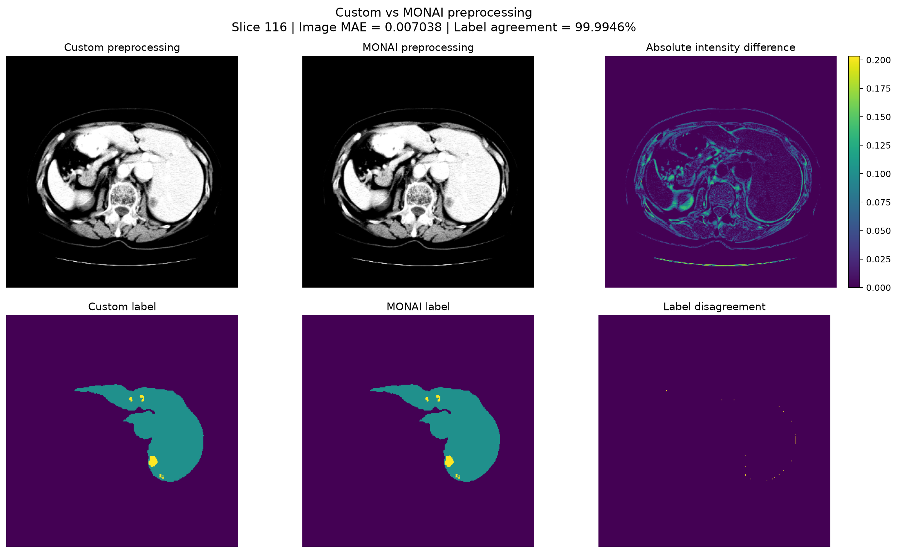

# CT Tumor Segmentation

End-to-end 3D CT tumor segmentation project using Python, PyTorch, MONAI, pydicom and medical imaging data.

This project was developed as a progressive medical-imaging AI workflow, starting from research-ready NIfTI volumes and evolving toward real clinical DICOM series, DICOM SEG objects, full-volume inference, anatomical constraints and MONAI-based pipelines.

The main goal is not only to train a segmentation model, but to understand the complete path from medical image acquisition and physical geometry to preprocessing, deep learning, evaluation and deployment-style inference.

---

# Project Goals

The project explores the complete workflow required for 3D CT tumor segmentation:

* medical image loading
* CT intensity interpretation
* Hounsfield Unit handling
* windowing
* normalization
* physical-space resampling
* 3D patch extraction
* data augmentation
* patient-level train/validation splitting
* 3D U-Net segmentation
* multiclass and binary tumor segmentation
* voxel-wise evaluation
* lesion-wise evaluation
* connected-component analysis
* probability-map inspection
* full-volume sliding-window inference
* DICOM series reconstruction
* DICOM SEG reconstruction
* anatomical liver constraints
* physical lesion-volume analysis
* MONAI preprocessing
* MONAI Dataset / CacheDataset
* MONAI tumor-aware training transforms
* MONAI sliding-window inference
* end-to-end MONAI inference

The project is intended for educational and research purposes.

It is not a medical device and is not intended for clinical diagnosis or treatment decisions.

---

# Core Idea

Medical AI is not only about the neural network.

A clinically meaningful pipeline must also correctly handle:

```text
Medical imaging data
        ↓
Image format and metadata
        ↓
Physical geometry
        ↓
Hounsfield Units
        ↓
Preprocessing
        ↓
3D segmentation model
        ↓
Evaluation
        ↓
Full-volume inference
        ↓
Clinical interoperability
```

Two principles became especially important during the project:

> **AI sees voxels; clinical imaging happens in millimeters.**

and:

> **Training is not deployment.**

A model trained on tumor-centered patches cannot automatically be assumed to work on an entire clinical CT volume where the tumor location is unknown.

---

# Technology Stack

The project currently uses:

* Python
* NumPy
* SciPy
* NiBabel
* Matplotlib
* PyTorch
* MONAI
* pydicom
* Jupyter
* Git / GitHub

---

# Repository Structure

```text
ct-tumor-segmentation/
│
├── data/
│   ├── multicase/
│   └── dicom/
│
├── docs/
│   └── images/
│
├── outputs/
│   ├── checkpoints/
│   └── evaluation/
│
├── src/
│   │
│   ├── analysis/
│   │   └── tumor_metrics.py
│   │
│   ├── data/
│   │   ├── __init__.py
│   │   ├── cases.py
│   │   ├── dataset.py
│   │   ├── io.py
│   │   ├── monai_dataset.py
│   │   └── split.py
│   │
│   ├── dicom/
│   │   ├── __init__.py
│   │   ├── intensity.py
│   │   ├── io.py
│   │   ├── reconstruction.py
│   │   ├── seg.py
│   │   └── series.py
│   │
│   ├── evaluation/
│   │   ├── __init__.py
│   │   ├── lesion_metrics.py
│   │   └── metrics.py
│   │
│   ├── inference/
│   │   ├── __init__.py
│   │   ├── sliding_window.py
│   │   ├── monai_sliding_window.py
│   │   └── monai_pipeline.py
│   │
│   ├── models/
│   │   ├── __init__.py
│   │   ├── losses.py
│   │   ├── simple_3d_cnn.py
│   │   └── unet3d.py
│   │
│   ├── preprocessing/
│   │   ├── augmentation.py
│   │   ├── labels.py
│   │   ├── monai_training_transforms.py
│   │   ├── monai_transforms.py
│   │   ├── normalization.py
│   │   ├── patches.py
│   │   ├── pipeline.py
│   │   ├── resampling.py
│   │   └── windowing.py
│   │
│   ├── training/
│   │   ├── __init__.py
│   │   ├── checkpoint.py
│   │   ├── train.py
│   │   ├── train_binary.py
│   │   └── validate.py
│   │
│   └── visualization/
│
├── tests/
│
├── .gitignore
├── README.md
└── requirements.txt
```

The `data/` and `outputs/` directories are intentionally excluded from Git.

Medical-image files and model checkpoints are also protected by `.gitignore`.

---

# Data

## Medical Segmentation Decathlon — Task03 Liver

The initial training and evaluation workflow uses the liver task from the Medical Segmentation Decathlon.

Label convention:

```text
0 = background
1 = liver
2 = tumor
```

The initial experimental subset contains:

```text
liver_0
liver_1
...
liver_9
```

The patient-level split uses a fixed random seed.

```text
Training:
8 patients

Validation:
2 patients
```

Training cases:

```text
liver_0
liver_1
liver_2
liver_4
liver_5
liver_6
liver_8
liver_9
```

Validation cases:

```text
liver_3
liver_7
```

The split is performed at patient level to avoid data leakage between training and validation patches.

---

# Phase 1 — Medical Image Exploration

The first phase focused on understanding the CT data before introducing a neural network.

For `liver_0`:

```text
Shape:
(512, 512, 75)

Intensity range:
approximately -1024 to 1410 HU

Voxel spacing:
0.703125 × 0.703125 × 5.0 mm

Label values:
[0, 1, 2]
```

This phase included:

* image loading
* segmentation-mask loading
* shape inspection
* voxel-spacing inspection
* label inspection
* tumor localization
* tumor-volume estimation
* axial visualization
* overlay visualization

A central lesson was that voxel counts alone do not represent physical volume.

Physical volume must include voxel spacing:

```text
physical volume
=
number of voxels
× spacing_x
× spacing_y
× spacing_z
```

This becomes especially important after resampling, because the number of voxels changes while the underlying anatomy does not.

---

# Phase 2 — Preprocessing

The preprocessing pipeline includes:

```text
CT volume
    ↓
windowing
    ↓
normalization
    ↓
resampling
    ↓
patch extraction
    ↓
augmentation
```

---

## CT Windowing

A soft-tissue liver window is used:

```text
Window center:
50 HU

Window width:
150 HU
```

This corresponds approximately to:

```text
-25 HU to 125 HU
```

Values outside the interval are clipped.

---

## Intensity Normalization

After windowing, intensities are normalized to:

```text
[0, 1]
```

The custom implementation uses:

```python
(image - min_value) / (max_value - min_value)
```

---

## Resampling

The target voxel spacing is:

```text
1.0 × 1.0 × 2.5 mm
```

The custom resampling implementation uses:

```python
zoom_factors = current_spacing / target_spacing
```

with `scipy.ndimage.zoom`.

Interpolation:

```text
CT image:
linear interpolation

Segmentation label:
nearest-neighbor interpolation
```

Nearest-neighbor interpolation is essential for segmentation labels because labels are discrete classes and must not be converted into artificial intermediate values.

For `liver_0`:

```text
Original:
512 × 512 × 75

Original spacing:
0.703125 × 0.703125 × 5.0 mm

Resampled:
approximately 360 × 360 × 150
```

---

## Physical Geometry

One of the most important lessons of the project is:

> **AI sees voxels; clinical imaging happens in millimeters.**

A CT volume can be highly anisotropic.

For example:

```text
0.742 × 0.742 × 3.0 mm
```

means that the axial resolution is much higher than the through-plane resolution.

This explains why coronal and sagittal reconstructions may appear visually coarser.

Resampling standardizes the physical grid.

It does not create new anatomy or recover information that was not acquired.

---

# Tumor-Centered Patch Extraction

The training patch size is:

```text
96 × 96 × 64
```

The custom patch strategy is tumor-aware.

For each training patient:

```text
tumor centroid
        ↓
small random spatial shift
        ↓
3D patch extraction
```

Maximum shifts:

```text
X: ±12 voxels
Y: ±12 voxels
Z: ±8 voxels
```

Five shifted patches are generated per training patient.

With eight training patients:

```text
8 patients × 5 patches
=
40 training patches
```

Validation uses one deterministic tumor-centered patch per patient.

---

# Data Augmentation

Training-time augmentation includes 3D flips.

Image and label transformations are always applied together so that spatial correspondence is preserved.

---

# Phase 3 — 3D Deep Learning

A compact 3D U-Net was implemented in PyTorch.

Main configuration:

```text
Input channels:
1

Base channels:
8

Output classes:
configurable
```

The architecture follows the standard encoder-decoder design:

```text
CT patch
   ↓
Encoder
   ↓
Bottleneck
   ↓
Decoder
   ↓
Skip connections
   ↓
Voxel-wise logits
```

---

# Multiclass Segmentation

The initial formulation used three classes:

```text
0 = background
1 = liver
2 = tumor
```

Training loss decreased, but hard tumor Dice remained very low.

Probability-map analysis showed that the model was learning a weak tumor-related signal even when the tumor class did not win the final `argmax`.

Example behavior:

```text
liver_3

mean tumor probability on GT tumor:
~0.112

mean tumor probability outside tumor:
~0.059
```

and:

```text
liver_7

mean tumor probability on GT tumor:
~0.161

mean tumor probability outside tumor:
~0.086
```

This suggested that the model was learning some tumor discrimination but not enough for reliable multiclass hard segmentation.

---

# Threshold Analysis

Tumor probability thresholds were explored diagnostically.

For example, on `liver_7`:

```text
threshold 0.10
high recall, very low precision

threshold 0.15
Dice improves

threshold 0.20+
prediction collapses rapidly
```

These thresholds were evaluated on the same validation patients.

They are therefore treated as exploratory and not as unbiased threshold selection.

---

# Binary Tumor Segmentation

The task was simplified to:

```text
0 = non-tumor
1 = tumor
```

The label conversion is:

```python
(label == 2).astype(np.int64)
```

Class weighting was used to address class imbalance.

Example binary weights:

```text
non-tumor:
0.10

tumor:
1.90
```

The binary model produced the first clearly non-zero hard tumor Dice on validation.

---

# Binary Training Result

At epoch 10:

```text
Train loss:
~1.1237

Validation loss:
~2.2197

Train tumor Dice:
~0.1322

Validation tumor Dice:
~0.2148
```

Separate checkpoints were maintained for:

```text
best validation loss
best tumor Dice
```

The main tumor-Dice checkpoint is:

```text
outputs/checkpoints/
best_real_binary_unet_best_tumor_dice.pt
```

---

# Phase 4 — Voxel-Wise Evaluation

Best tumor-Dice checkpoint:

## liver_3

```text
Dice:
0.0000

Precision:
0.0000

Recall:
0.0000

Ground-truth tumor voxels:
529

Predicted tumor voxels:
0
```

This is a complete miss.

---

## liver_7

```text
Dice:
0.4296

IoU:
0.2735

Precision:
0.9875

Recall:
0.2745

Ground-truth tumor voxels:
6350

Predicted tumor voxels:
1765
```

This represents a different failure mode:

```text
very high precision
+
low recall
=
conservative under-segmentation
```

The two validation cases demonstrate why aggregate metrics alone can be misleading.

---

# Lesion-Wise Evaluation

A lesion-level evaluation was implemented using 3D connected components with 26-connectivity.

## liver_3

```text
GT lesions:
1

Predicted lesions:
0

Detected:
0

Missed:
1

False positives:
0

Lesion sensitivity:
0.0
```

## liver_7

```text
GT lesions:
3

Predicted lesions:
6

Detected:
2

Missed:
1

False positives:
3

Lesion sensitivity:
0.6667
```

---

# Connected-Component Post-Processing

Small predicted components were filtered.

For `liver_7`, after removing components smaller than 20 voxels:

```text
Predicted lesions:
6 → 3

False-positive lesions:
3 → 0
```

Voxel-level metrics changed only slightly:

```text
Dice:
0.4296 → 0.4307

IoU:
0.2735 → 0.2744

Precision:
0.9875 → 0.9994

Recall:
approximately unchanged
```

This illustrates an important point:

> Post-processing can remove fragmentation and false positives, but it cannot recover lesions the model never predicted.

---

# Phase 5 — Clinical Imaging Workflow

The next phase moved from research-ready NIfTI data to real DICOM imaging.

The goal was to understand the clinical acquisition layer:

```text
DICOM files
    ↓
series discovery
    ↓
series grouping
    ↓
spatial sorting
    ↓
HU reconstruction
    ↓
3D CT volume
    ↓
AI preprocessing
    ↓
full-volume inference
```

---

# DICOM Discovery

DICOM files are discovered and grouped using:

```text
SeriesInstanceUID
```

The workflow does not rely on filenames or file extensions.

This is important because clinical imaging directories may contain multiple series and different DICOM object types.

---

# DICOM Slice Sorting

Slices are not sorted using filenames.

Spatial sorting uses:

```text
ImageOrientationPatient
ImagePositionPatient
```

The slice normal is derived from the row and column orientation vectors.

Conceptually:

```text
slice_normal
=
row_direction × column_direction
```

and slice position is obtained from:

```text
dot(ImagePositionPatient, slice_normal)
```

This produces a geometrically robust ordering.

---

# DICOM to Hounsfield Units

Stored CT pixel values are converted using:

```text
HU
=
stored pixel value
× RescaleSlope
+ RescaleIntercept
```

A pydicom example CT produced:

```text
Stored values:
128 to 2191

Slope:
1

Intercept:
-1024

HU:
-896 to 1167
```

---

# Real DICOM Series

## LIDC-IDRI CT

A thoracic CT series was reconstructed:

```text
Slices:
133

Shape:
512 × 512 × 133

Spacing:
0.703125 × 0.703125 × 2.5 mm

Geometry:
regular

Irregular intervals:
0
```

This dataset was used primarily to validate the technical DICOM reconstruction pipeline.

---

# TCGA-LIHC Liver CT

A liver case from NCI Imaging Data Commons was then used.

## Portal Venous Series

```text
Description:
P.Venous 3.0 B40f

Slices:
83

Shape:
512 × 512 × 83

Spacing:
0.7421875 × 0.7421875 × 3.0 mm

HU:
approximately -1024 to 1992
```

After preprocessing and resampling:

```text
380 × 380 × 100
```

with target spacing:

```text
1.0 × 1.0 × 2.5 mm
```

This step demonstrated that once the DICOM volume is correctly reconstructed in HU, the same preprocessing concepts used for NIfTI can be reused.

---

# Training Is Not Deployment

The training pipeline used tumor-centered patches.

During training:

```text
tumor location is known
```

because the ground-truth segmentation is available.

In real inference:

```text
tumor location is unknown
```

The model must therefore search the entire volume.

This creates a major distribution shift:

```text
Training
-------
tumor-centered
local patches
high tumor exposure

Deployment
----------
whole abdomen
unknown tumor location
many negative regions
different anatomy
```

A model trained on local tumor-centered patches does not automatically become a full-volume segmenter.

---

# Sliding-Window Full-Volume Inference

A custom sliding-window implementation was developed.

For an approximately:

```text
380 × 380 × 100
```

volume, using:

```text
patch:
96 × 96 × 64

overlap:
0.5
```

the window starts were:

```text
X:
[0, 48, 96, 144, 192, 240, 284]

Y:
[0, 48, 96, 144, 192, 240, 284]

Z:
[0, 32, 36]
```

Total:

```text
147 patches
```

Overlapping probability maps are accumulated and averaged voxel-by-voxel.

---

# External DICOM Inference

Full-volume inference was applied to the external portal-venous CT.

Example output:

```text
Probability range:
0.0 to approximately 0.535

Mean probability:
approximately 0.00545

Predicted positive voxels at threshold 0.5:
2260
```

The probability response was sparse but frequently located outside the liver.

This was interpreted as evidence of:

* domain shift
* limited generalization
* training/inference mismatch
* insufficient negative sampling

Lowering the threshold was not considered a valid solution because it would likely increase false positives.

---

# DICOM SEG

A liver DICOM SEG object from the same study was analyzed.

Metadata:

```text
Modality:
SEG

Segment label:
Liver

Algorithm type:
AUTOMATIC

Algorithm:
BAMF-Liver-CT

Frames:
43
```

A key discovery was that the DICOM SEG did **not** reference the portal-venous CT series.

It referenced a different CT series.

This demonstrated an important rule:

> **Matching array dimensions do not imply matching medical-image geometry.**

DICOM relationships must be followed using:

* SeriesInstanceUID
* SOPInstanceUID
* frame-level references

---

# Arterial CT Series

The DICOM SEG referenced the arterial CT series.

The correct arterial series was downloaded and reconstructed.

```text
Slices:
84

Description:
Arterial 3.0 B40f
```

The SEG frames were mapped to CT slices through referenced SOP Instance UIDs.

Result:

```text
CT slices:
84

SEG frames:
43

Matched SEG frames:
43

Full mask shape:
512 × 512 × 84

Label values:
[0, 1]

Liver voxels:
1,059,754

Slices containing liver:
43

First liver slice:
37

Last liver slice:
79
```

Visual overlay confirmed correct geometric alignment.

---

# DICOM SEG Is Not Manual Ground Truth

The liver segmentation used in this phase is:

```text
automatic segmentation
```

generated by:

```text
BAMF-Liver-CT
```

It should therefore not be interpreted as independent manual ground truth.

It is used as an anatomical prior and geometric reference.

---

# Arterial CT + Liver Mask Resampling

Both arterial CT and liver mask were resampled into the same target space.

Original:

```text
512 × 512 × 84
```

Resampled:

```text
approximately 380 × 380 × 101
```

Target spacing:

```text
1.0 × 1.0 × 2.5 mm
```

The segmentation mask was resampled using nearest-neighbor interpolation.

---

# Anatomical Liver Constraint

The binary tumor model was applied to the arterial CT.

Raw prediction:

```text
4807 positive voxels
```

After applying the liver mask:

```text
625 positive voxels
```

Removed outside the liver:

```text
4182 voxels
```

Fraction removed:

```text
approximately 87%
```

This shows that the model produced many anatomically implausible extrahepatic responses.

The liver mask acts as an anatomical prior.

However:

> **An anatomical constraint can remove impossible predictions; it cannot turn an incorrect intra-organ prediction into a true lesion.**

The remaining intrahepatic candidate is therefore considered anatomically plausible, not clinically confirmed.

---

# Connected Components in Physical Space

After liver-constrained inference:

```text
Positive voxels:
625

Connected components:
14
```

With target spacing:

```text
1.0 × 1.0 × 2.5 mm
```

each voxel represents:

```text
2.5 mm³
```

The dominant component contained:

```text
464 voxels
```

which corresponds to:

```text
1160 mm³
=
1.160 mL
```

This component represented approximately:

```text
74%
```

of all intrahepatic positive voxels.

---

# Physical Component Filtering

An exploratory minimum physical volume of:

```text
50 mm³
```

was used.

With voxel volume:

```text
2.5 mm³
```

this corresponds to:

```text
20 voxels
```

Results:

```text
Components:
14 → 5

Positive voxels:
625 → 590

Components removed:
9

Voxels removed:
35

Fraction of positive voxels removed:
5.6%
```

This shows that the filter removed many tiny fragmented components while preserving most of the dominant predicted region.

The threshold is exploratory and is not clinically validated.

---

# Phase 6 — MONAI Integration

After implementing the preprocessing, patch sampling, dataset handling and sliding-window inference logic from scratch, MONAI was integrated as a medical-imaging-specific framework to reproduce and standardize the same workflow.

The goal was not to replace the custom implementation blindly.

Instead, MONAI was introduced only after the original pipeline had been developed and understood.

The two approaches were then compared quantitatively.

---

# Why Both Custom and MONAI Implementations?

The custom implementation was developed first to understand the mechanics of:

* CT intensity preprocessing
* windowing
* normalization
* voxel spacing
* resampling
* interpolation
* tumor-centered patch extraction
* augmentation
* dataset organization
* full-volume sliding-window inference
* probability aggregation

MONAI was then introduced to reproduce the same workflow using standardized medical-imaging components.

This provides complementary benefits.

## Custom Implementation

Advantages:

* transparency
* direct control
* educational value
* easier inspection of intermediate steps
* deeper understanding of the algorithms

## MONAI Implementation

Advantages:

* standardized medical-imaging transforms
* reusable pipeline components
* Dataset and CacheDataset support
* medical-imaging-aware metadata handling
* reproducible preprocessing
* reusable training transforms
* standardized sliding-window inference
* easier extension to larger research workflows

---

# MONAI Preprocessing

The MONAI preprocessing pipeline reproduces the original custom workflow.

Steps:

```text
Load NIfTI
    ↓
Ensure channel-first
    ↓
CT windowing
    ↓
Intensity scaling
    ↓
Physical-space resampling
    ↓
Tensor conversion
```

Target intensity range:

```text
0 to 1
```

Target spacing:

```text
1.0 × 1.0 × 2.5 mm
```

Interpolation:

```text
CT:
continuous interpolation

Label:
nearest neighbor
```

---

# Custom vs MONAI Preprocessing

The two pipelines were compared directly on `liver_0`.

Results:

```text
Custom shape:
(360, 360, 150)

MONAI shape:
(360, 360, 150)

Custom intensity range:
0.0 to 1.0

MONAI intensity range:
0.0 to 1.0

Custom label values:
[0, 1, 2]

MONAI label values:
[0, 1, 2]
```

Quantitative comparison:

```text
Image MAE:
0.007038

Label voxel agreement:
99.9946%

Mismatched label voxels:
1056

Label mismatch:
0.00543%
```

Residual differences are mainly localized around interpolation-sensitive anatomical and segmentation boundaries.



This comparison demonstrates that the MONAI preprocessing pipeline reproduces the original custom behavior very closely.

---

# MONAI Dataset and CacheDataset

A MONAI-compatible dataset pipeline was implemented using:

```text
Dataset
CacheDataset
```

The 10-case experimental dataset is represented using dictionaries such as:

```python
{
    "image": "data/multicase/images/liver_0.nii.gz",
    "label": "data/multicase/labels/liver_0.nii.gz",
    "case_id": "liver_0"
}
```

---

## Dataset Timing

Standard `Dataset` first access:

```text
~3.36 seconds
```

`CacheDataset` construction for 10 cases:

```text
~114.46 seconds
```

After caching:

```text
First cached access:
~0.00143 seconds

Second cached access:
~0.00012 seconds
```

Dataset and CacheDataset outputs were identical:

```text
Image MAE:
0.0

Label agreement:
1.0
```

This demonstrates the main advantage of caching deterministic preprocessing before repeated training access.

---

# MONAI Tumor-Aware Training Transforms

The first MONAI experiment used:

```text
RandCropByLabelClassesd
```

to sample tumor voxels.

This successfully produced tumor-containing patches, but it did not fully reproduce the original custom strategy.

The standard MONAI transform may center the patch on any tumor voxel, including a voxel near the tumor boundary.

The original custom pipeline instead uses:

```text
tumor centroid
+
controlled random shift
```

To preserve this behavior, a custom MONAI-compatible transform was implemented.

---

# Tumor-Centered MONAI Crop

The MONAI training pipeline now uses:

```text
tumor centroid
+
random shift
```

Maximum shift:

```text
X:
±12 voxels

Y:
±12 voxels

Z:
±8 voxels
```

Patch size:

```text
96 × 96 × 64
```

Example:

```text
Tumor center:
[222, 167, 123]

Crop center:
[225, 167, 115]

Crop shift:
[3, 0, -8]
```

Validation uses:

```text
tumor centroid
+
[0, 0, 0]
```

with no random augmentation.

This makes the validation crop deterministic and reproducible.

---

# MONAI Training Augmentation

Training-time MONAI transforms include random 3D flips along the spatial axes.

Image and segmentation label are transformed together.

This preserves exact image-mask alignment.

---

# MONAI Sliding-Window Inference

MONAI full-volume inference was implemented using:

```text
roi_size:
96 × 96 × 64

overlap:
0.5
```

Uniform weighting is used in overlapping regions to remain as close as possible to the original custom probability-averaging strategy.

---

# MONAI Sliding-Window Reconstruction Test

A synthetic identity model was used to validate only the sliding-window mechanics.

Input:

```text
380 × 380 × 100
```

Output:

```text
1 × 2 × 380 × 380 × 100
```

Results:

```text
Reconstruction MAE:
1.23e-08

Maximum difference:
4.17e-07
```

The differences are at floating-point numerical precision.

This confirms correct:

* patch extraction
* overlap handling
* stitching
* full-volume reconstruction

---

# Custom vs MONAI Sliding-Window Inference

The custom and MONAI sliding-window implementations were evaluated using:

* the same `liver_7` volume
* the same preprocessed input
* the same binary U-Net checkpoint
* the same patch size
* the same overlap
* the same threshold

Custom function output:

```text
probability map
+
binary mask
```

The raw probability maps were compared directly.

Results:

```text
Probability MAE:
0.001278

Median probability difference:
3.41e-13

Maximum local probability difference:
0.3426
```

At threshold:

```text
0.5
```

both implementations produced:

```text
Custom positive voxels:
19,454

MONAI positive voxels:
19,454

Mismatched mask voxels:
0

Mask voxel agreement:
100%

Dice custom vs MONAI:
1.0
```

Therefore, the two sliding-window implementations produced identical final binary masks.

Small localized probability differences did not change the final segmentation.

---

# End-to-End MONAI Inference Pipeline

The complete MONAI inference workflow is now:

```text
NIfTI CT
    ↓
MONAI preprocessing
    ↓
resampling
    ↓
3D U-Net
    ↓
MONAI sliding-window inference
    ↓
tumor probability map
    ↓
threshold
    ↓
binary tumor mask
```

Example on `liver_7`:

```text
Probability shape:
(383, 383, 216)

Mask shape:
(383, 383, 216)

Probability range:
0.0 to 0.5301

Probability mean:
~0.00380

Threshold:
0.5

Positive voxels:
19,918

Positive voxel fraction:
~0.0629%
```

The fully MONAI-based pipeline does not produce exactly the same positive-voxel count as the custom preprocessing pipeline.

This is expected.

The MONAI preprocessing performs affine-aware physical-space resampling, while the original implementation uses `scipy.ndimage.zoom`.

Small interpolation differences can move probabilities around the threshold.

This distinction is important:

```text
same sliding-window input
→ custom and MONAI produce identical binary masks

different preprocessing implementation
→ small differences can propagate to final thresholded output
```

---

# NIfTI vs DICOM

An important conclusion of the project is that NIfTI and DICOM occupy different roles in the workflow.

## NIfTI

Typical characteristics:

* research-oriented
* compact 3D volume
* convenient for machine learning
* volume already reconstructed
* commonly used with segmentation labels

## DICOM

Typical characteristics:

* clinical acquisition format
* many individual objects
* rich metadata
* spatial geometry
* series relationships
* patient-space information
* interoperability
* derived objects such as DICOM SEG

Conceptually:

```text
DICOM
    ↓
clinical acquisition layer
    ↓
series selection
    ↓
spatial reconstruction
    ↓
HU conversion
    ↓
preprocessing
    ↓
AI-ready representation
```

---

# Key Technical Lessons

## 1. Physical geometry matters

```text
AI sees voxels.
Clinical imaging happens in millimeters.
```

Voxel spacing affects:

* lesion size
* physical volume
* patch coverage
* anisotropy
* resampling
* cross-patient comparability

---

## 2. Training is not deployment

Tumor-centered patch training assumes known lesion location.

Clinical inference does not.

Whole-volume deployment requires:

* search over the entire anatomy
* negative-region handling
* sliding-window inference
* stronger generalization

---

## 3. Same shape does not mean same geometry

Two medical images can have identical array dimensions but represent different patient-space locations.

DICOM geometry must be verified through metadata and references.

---

## 4. Probability is not diagnosis

A high model probability does not prove that a lesion is malignant.

Model outputs must be validated against independent ground truth.

---

## 5. Anatomical plausibility is not correctness

Constraining predictions to the liver removes impossible extrahepatic detections.

It does not prove that the remaining intrahepatic prediction is a tumor.

---

## 6. Voxel count is not physical volume

After resampling:

```text
number of voxels changes
```

but anatomical volume must be evaluated using:

```text
voxel_count × voxel_volume
```

---

## 7. Post-processing cannot recover missing information

Connected-component filtering can:

* remove tiny fragments
* reduce false-positive components
* improve anatomical cleanliness

but cannot recover lesions that the network completely missed.

---

# Important Limitations

The project is a proof of concept.

Current limitations include:

* only 8 training patients
* only 2 validation patients
* small experimental cohort
* correlated shifted patches from the same patients
* tumor-centered training distribution
* limited full-volume negative sampling
* external DICOM domain shift
* threshold analysis performed on validation data
* no independent external tumor ground truth for the DICOM case
* automatic liver DICOM SEG rather than manual segmentation
* no clinical validation

No result in this repository should be interpreted as clinical diagnostic performance.

---

# Reproducibility Notes

Random seeds were fixed where appropriate.

The patient split uses:

```text
seed = 42
```

Data augmentation and patch sampling were also developed with reproducibility and explicit random-state handling in mind.

Validation transforms are deterministic.

---

# Git and Data Safety

Medical data are intentionally excluded from version control.

The `.gitignore` includes:

```text
/data/
outputs/

*.dcm
*.nii
*.nii.gz

*.pt
*.pth
*.ckpt

__pycache__/
.ipynb_checkpoints/
```

The leading slash in:

```text
/data/
```

is important.

It ensures that only the root medical-data directory is ignored, while source-code modules under:

```text
src/data/
```

remain tracked.

---

# Testing

The project contains focused tests for individual components.

Examples include:

```text
preprocessing
resampling
normalization
augmentation
dataset loading
patient splitting
patch extraction
training
validation
evaluation metrics
DICOM discovery
DICOM HU conversion
DICOM slice sorting
DICOM reconstruction
DICOM SEG reconstruction
sliding-window geometry
MONAI preprocessing
MONAI Dataset / CacheDataset
MONAI tumor-aware transforms
MONAI sliding-window inference
custom vs MONAI inference
end-to-end MONAI inference
```

Example commands:

```powershell
python -m tests.test_monai_preprocessing
python -m tests.test_monai_dataset
python -m tests.test_monai_training_transforms
python -m tests.test_monai_sliding_window
python -m tests.test_custom_vs_monai_sliding_window
python -m tests.test_monai_inference_pipeline
```

A general syntax check can also be performed with:

```powershell
python -m compileall src tests
```

---

# Current Project Status

The project currently includes:

```text
NIfTI medical-image loading                 ✅
CT windowing                                ✅
Intensity normalization                     ✅
Physical-space resampling                   ✅
Tumor-centered patch extraction             ✅
3D augmentation                             ✅
Patient-level train/validation split        ✅
3D U-Net                                    ✅
Multiclass segmentation                     ✅
Binary tumor segmentation                   ✅
Voxel-wise evaluation                       ✅
Lesion-wise evaluation                      ✅
Connected-component analysis                ✅
Probability-map inspection                  ✅
Custom sliding-window inference             ✅
DICOM discovery                             ✅
DICOM series grouping                       ✅
DICOM geometry reconstruction               ✅
DICOM HU conversion                         ✅
Real DICOM CT reconstruction                ✅
DICOM SEG reconstruction                    ✅
Anatomical liver constraint                 ✅
Physical connected-component filtering      ✅
MONAI preprocessing                         ✅
MONAI preprocessing validation              ✅
MONAI Dataset                               ✅
MONAI CacheDataset                          ✅
MONAI tumor-centered transforms             ✅
MONAI deterministic validation transforms   ✅
MONAI sliding-window inference              ✅
Custom vs MONAI inference comparison        ✅
End-to-end MONAI inference                  ✅
```

---

# Roadmap

## Phase 1 — Medical Image Exploration

* [x] Load CT NIfTI volumes
* [x] Load segmentation labels
* [x] Inspect shape and spacing
* [x] Inspect HU distribution
* [x] Visualize axial slices
* [x] Visualize tumor overlays
* [x] Estimate physical tumor volume

---

## Phase 2 — Preprocessing

* [x] CT windowing
* [x] Intensity normalization
* [x] Physical-space resampling
* [x] Nearest-neighbor label resampling
* [x] Tumor-centered patch extraction
* [x] Boundary-safe patch extraction
* [x] 3D data augmentation
* [x] Patient-level train/validation split
* [x] Multi-patch training dataset

---

## Phase 3 — Deep Learning

* [x] Simple 3D CNN prototype
* [x] 3D U-Net implementation
* [x] Multiclass training
* [x] Weighted loss
* [x] Binary tumor formulation
* [x] Binary U-Net training
* [x] Checkpoint management
* [x] Training and validation loops

---

## Phase 4 — Evaluation

* [x] Dice
* [x] IoU
* [x] Precision
* [x] Recall
* [x] Probability-map analysis
* [x] Threshold analysis
* [x] Lesion-wise evaluation
* [x] Connected-component analysis
* [x] Small-component filtering
* [x] CSV evaluation outputs
* [x] Prediction visualization

---

## Phase 5 — Clinical Imaging Workflow

* [x] Install and integrate pydicom
* [x] DICOM file discovery
* [x] Series grouping
* [x] Spatial slice sorting
* [x] HU conversion
* [x] 3D DICOM reconstruction
* [x] Slice-spacing validation
* [x] Real LIDC-IDRI CT reconstruction
* [x] TCGA-LIHC liver CT reconstruction
* [x] Portal-venous CT preprocessing
* [x] Full-volume sliding-window inference
* [x] External DICOM domain-shift analysis
* [x] DICOM SEG inspection
* [x] DICOM SEG reference validation
* [x] Correct arterial CT reconstruction
* [x] DICOM SEG mask reconstruction
* [x] CT / SEG resampling
* [x] Liver-constrained tumor inference
* [x] Physical connected-component analysis

Future work:

* [ ] Further domain-shift analysis
* [ ] Larger-patient full-volume evaluation
* [ ] Tumor ground-truth integration for external DICOM studies
* [ ] Improved liver-aware model training
* [ ] DICOM SEG export of model predictions
* [ ] RTSTRUCT exploration

---

## Phase 6 — MONAI Integration

* [x] Install MONAI
* [x] MONAI preprocessing pipeline
* [x] Custom vs MONAI preprocessing comparison
* [x] Visual preprocessing comparison
* [x] MONAI Dataset
* [x] MONAI CacheDataset
* [x] Dataset / CacheDataset numerical equivalence
* [x] MONAI tumor-aware patch sampling
* [x] Custom MONAI tumor-centered crop
* [x] Controlled training shifts
* [x] Deterministic validation crop
* [x] MONAI 3D augmentation
* [x] MONAI sliding-window inference
* [x] Sliding-window reconstruction test
* [x] Custom vs MONAI probability comparison
* [x] Custom vs MONAI binary-mask equivalence
* [x] End-to-end MONAI NIfTI inference pipeline

Future MONAI work:

* [ ] Larger-scale MONAI training experiment
* [ ] MONAI-based external DICOM inference integration
* [ ] GPU performance benchmarking
* [ ] MONAI-based experiment configuration
* [ ] MONAI-native training pipeline comparison

---

# Future Directions

Several extensions could significantly improve the project.

## Better Training Strategy

Potential improvements:

* liver-centered patches
* negative liver patches
* hard-negative mining
* balanced tumor / non-tumor sampling
* larger patient cohort
* full-volume training experiments

---

## External Validation

A meaningful next step would require:

* larger independent cohorts
* tumor ground truth
* scanner diversity
* multiple institutions
* different contrast phases

---

## Clinical Interoperability

Potential future work:

```text
AI prediction
    ↓
DICOM SEG generation
    ↓
clinical viewer
    ↓
radiologist review
```

RTSTRUCT interoperability could also be explored.

---

## Research User Interface

A future research workstation could include:

* DICOM study loading
* axial / coronal / sagittal visualization
* liver segmentation overlay
* AI tumor candidate overlay
* probability visualization
* lesion volume
* connected-component analysis
* accept / reject candidate review
* DICOM SEG export

Such an interface would currently be considered a research prototype rather than a clinically validated medical device.

---

# Possible Future Research Extension

The project architecture could later be adapted to other oncological problems.

One possible direction is ovarian cancer.

Potential extensions include:

* HGSOC imaging
* radiomics
* radiogenomics
* BRCA / HRD-related analysis
* age-aware analysis
* molecular biomarkers
* therapy-response modeling
* precision oncology research

These topics are outside the current liver segmentation scope and would be developed as separate research projects.

---

# Scientific Interpretation

The main result of the project is not a single Dice score.

The most important outcome is the construction of an end-to-end understanding of medical-imaging AI:

```text
data
↓
physics
↓
geometry
↓
preprocessing
↓
deep learning
↓
evaluation
↓
deployment
↓
clinical interoperability
```

The project demonstrates both:

```text
from-scratch understanding
```

and:

```text
standardized MONAI-based implementation
```

This combination is intentional.

---

# Final Takeaways

1. **Medical AI is a system, not only a model.**

2. **Physical geometry and metadata are part of the AI problem.**

3. **NIfTI and DICOM serve different roles in the imaging workflow.**

4. **AI sees voxels; clinical imaging happens in millimeters.**

5. **Training on tumor-centered patches is not equivalent to full-volume deployment.**

6. **Matching array dimensions does not guarantee matching medical-image geometry.**

7. **Anatomical constraints improve plausibility, not diagnostic certainty.**

8. **Post-processing can remove noise but cannot recover missing lesions.**

9. **Custom implementations help understand the mechanics.**

10. **MONAI helps standardize and scale the workflow.**

---

# Disclaimer

This repository is an educational and research project.

The models, predictions, thresholds and post-processing methods have not been clinically validated.

They must not be used for diagnosis, treatment planning or patient-care decisions.

All medical-imaging results should be interpreted as experimental outputs only.
