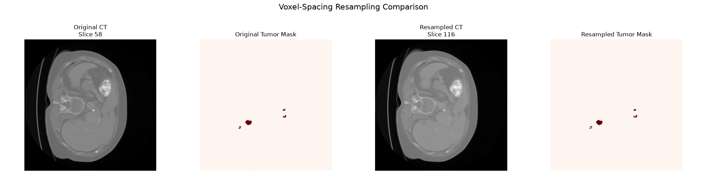

# CT Tumor Segmentation

3D CT medical imaging project for liver tumor analysis, preprocessing and future deep learning segmentation.

## Overview

This project explores the complete workflow for liver tumor segmentation from 3D CT imaging.

The current phase focuses on medical image exploration and preprocessing using NIfTI volumes from the Medical Segmentation Decathlon Task03 Liver dataset.

The long-term objective is to build a complete deep learning pipeline for 3D tumor segmentation using PyTorch and MONAI.

## Project Structure

```text
ct-tumor-segmentation/
├── configs/
├── data/
│   └── sample/
│       ├── image/
│       │   └── liver_0.nii.gz
│       └── label/
│           └── liver_0.nii.gz
├── docs/
│   └── images/
│       ├── liver_0_preprocessing_comparison.png
│       ├── liver_0_tumor_overlay.png
│       └── liver_0_windowing_comparison.png
├── notebooks/
├── outputs/
├── src/
│   ├── __init__.py
│   ├── analysis/
│   │   ├── __init__.py
│   │   └── tumor_metrics.py
│   ├── data/
│   │   ├── __init__.py
│   │   └── io.py
│   ├── preprocessing/
│   │   ├── __init__.py
│   │   ├── normalization.py
│   │   └── windowing.py
│   └── visualization/
│       ├── __init__.py
│       ├── compare_preprocessing.py
│       ├── compare_windowing.py
│       └── plot_slice.py
├── tests/
│   ├── __init__.py
│   ├── test_io.py
│   ├── test_normalization.py
│   ├── test_preprocessing_visualization.py
│   ├── test_tumor_metrics.py
│   ├── test_visualization.py
│   ├── test_windowing.py
│   └── test_windowing_visualization.py
├── .gitignore
├── README.md
└── requirements.txt
```
## Dataset

The project currently uses a sample case from the Medical Segmentation Decathlon Task03 Liver dataset.

The sample includes:

a 3D CT volume
a corresponding segmentation mask
liver annotations
tumor annotations

The CT volume has shape:

(512, 512, 75)

The segmentation labels are:

0 = Background
1 = Liver
2 = Tumor

## NIfTI Loading

NIfTI medical imaging volumes are loaded using nibabel.

The loading utility returns:

the 3D image volume as a NumPy array
the affine matrix associated with the NIfTI image

For the current sample CT, the original intensity range is approximately:

Minimum: -1024 HU
Maximum: 1410 HU

These values are expressed in Hounsfield Units, which are commonly used in CT imaging to represent tissue attenuation.

## Voxel Spacing

The voxel spacing extracted from the NIfTI affine matrix is approximately:

0.703125 mm × 0.703125 mm × 5.0 mm

This indicates that the volume is anisotropic.

The in-plane resolution is approximately 0.7 mm, while the slice thickness along the third dimension is 5 mm.

This difference will become important during voxel-spacing resampling before deep learning training.

## Tumor Slice Detection

The segmentation mask is analyzed to identify the axial slice containing the highest number of tumor voxels.

For the current sample case:

Slice index: 58
Tumor voxels in slice: 538

This allows the project to automatically select a representative tumor slice for visualization.

## Tumor Visualization

The project currently generates a three-panel visualization containing:

the original CT slice
the ground-truth tumor segmentation mask
the CT image with tumor mask overlay

The segmentation shown in this figure comes from the dataset ground-truth annotation.

At this stage, the tumor segmentation is not produced by an artificial intelligence model.

## Quantitative Tumor Analysis

Tumor volume is estimated from the segmentation mask using the voxel dimensions extracted from the NIfTI affine matrix.

For the current sample:

Voxel spacing:
[0.703125, 0.703125, 5.0] mm

Tumor voxels:
2591

Tumor volume:
6404.75 mm³

Tumor volume:
6.40 cm³

The volume is calculated as:

tumor voxel count × voxel volume

The resulting value is derived from the dataset annotation and is intended for educational and research purposes only.

## CT Intensity Windowing

CT volumes contain a large range of Hounsfield Unit values.

The original CT sample contains values approximately between:

-1024 HU and 1410 HU

To emphasize a selected range of soft tissues, CT intensity windowing is applied.

The current parameters are:

Window center: 50 HU
Window width: 150 HU

The corresponding intensity interval is:

-25 HU to 125 HU

The lower and upper limits are calculated as:

lower = center - width / 2
upper = center + width / 2

Values outside this interval are clipped using NumPy.

The comparison shows the difference between the original CT image and the windowed CT image.

Windowing does not create new anatomical information. It restricts the displayed intensity range to improve contrast within selected tissues.

## Intensity Normalization

After windowing, the CT image is normalized using min-max normalization.

The windowed intensity range:

-25 to 125

is transformed into:

0 to 1

using the formula:

normalized = (image - min_value) / (max_value - min_value)

The current preprocessing pipeline can therefore be summarized as:

Original CT
    ↓
CT Windowing
    ↓
Intensity range: -25 to 125 HU
    ↓
Min-Max Normalization
    ↓
Intensity range: 0 to 1

The complete preprocessing comparison is shown below:

The windowed and normalized images appear visually very similar.

This is expected because normalization changes the numerical representation of the intensity values without changing the underlying anatomical structures.

## Voxel-Spacing Resampling

The original CT volume has anisotropic voxel spacing:

0.703125 × 0.703125 × 5.0 mm

The volume is resampled to:

1.0 × 1.0 × 2.5 mm

The original shape:

(512, 512, 75)

becomes:

(360, 360, 150)

The corresponding zoom factors are:

[0.703125, 0.703125, 2.0]

Linear interpolation is used for CT intensity values, while nearest-neighbor interpolation is used for segmentation masks.

Nearest-neighbor interpolation is important for segmentation masks because it preserves the discrete class labels.

Before resampling:

[0, 1, 2]

After resampling:

[0, 1, 2]

The comparison below shows the CT volume and tumor mask before and after voxel-spacing resampling:



## Current Preprocessing Pipeline

The implemented preprocessing steps are currently:

NNIfTI CT Volume
      ↓
Load CT data
      ↓
Inspect HU intensity range
      ↓
CT intensity windowing
      ↓
Min-max normalization
      ↓
Voxel-spacing resampling
      ↓
Preprocessed CT volume

These operations prepare the CT data for later deep learning processing.

## Current Python Stack

The project currently uses:

Python
NumPy
NiBabel
Matplotlib

Future phases are expected to introduce:

PyTorch
MONAI
SimpleITK
additional medical imaging tools
segmentation evaluation metrics

## Current Features

 Load NIfTI CT volumes
 Load segmentation masks
 Inspect volume dimensions
 Inspect Hounsfield Unit intensity range
 Extract voxel spacing
 Analyze segmentation labels
 Identify tumor voxels
 Detect the slice containing the largest tumor area
 Visualize CT slices
 Visualize tumor masks
 Overlay tumor annotations
 Calculate tumor volume
 Apply CT intensity windowing
 Normalize CT intensities to the range [0, 1]
 Visualize the preprocessing pipeline
 Resample volumes to consistent voxel spacing
 Create train and validation splits
 Extract 3D image patches
 Apply data augmentation
 Build PyTorch datasets
 Train a 3D segmentation network
 Evaluate segmentation performance

## Roadmap

### Phase 1 — Medical Image Exploration

- [x] Load NIfTI CT volumes
- [x] Load segmentation masks
- [x] Inspect voxel spacing
- [x] Inspect segmentation labels
- [x] Visualize CT slices
- [x] Overlay tumor annotations
- [x] Detect tumor-rich slices
- [x] Calculate tumor volume

### Phase 2 — Preprocessing

- [x] CT intensity windowing
- [x] Intensity normalization
- [x] Voxel-spacing resampling
- [ ] Train/validation split
- [ ] 3D patch extraction
- [ ] Data augmentation

### Phase 3 — Deep Learning

- [ ] PyTorch dataset
- [ ] MONAI transforms
- [ ] 3D U-Net
- [ ] Dice loss
- [ ] Training pipeline
- [ ] Validation pipeline
- [ ] Checkpoint saving

### Phase 4 — Evaluation

- [ ] Dice score
- [ ] IoU / Jaccard index
- [ ] Precision
- [ ] Recall / Sensitivity
- [ ] Lesion-wise evaluation
- [ ] Error analysis

### Phase 5 — Clinical Imaging Workflow

- [ ] DICOM loading
- [ ] DICOM series reconstruction
- [ ] Hounsfield Unit handling
- [ ] DICOM SEG / RTSTRUCT exploration
- [ ] Inference on clinical-style imaging data

## Educational Goals

The project is also intended as a practical learning path covering:

Python programming for medical imaging
NumPy array manipulation
3D medical image formats
NIfTI metadata and affine matrices
Hounsfield Units
CT windowing
intensity normalization
medical image visualization
quantitative image analysis
preprocessing for deep learning
3D semantic segmentation

## Future Direction

The next preprocessing step will focus on voxel-spacing resampling.

The current CT volume has anisotropic spacing:

0.703125 × 0.703125 × 5.0 mm

Future processing will resample the CT volume and segmentation mask toward a more consistent spatial resolution.

Particular attention will be required when resampling segmentation masks, because discrete label values must be preserved.

After preprocessing is completed, the project will move toward a 3D deep learning segmentation pipeline using PyTorch and MONAI.

## Disclaimer

This project is developed for educational and research purposes only.

It is not a medical device and must not be used for clinical diagnosis, treatment planning or medical decision-making.